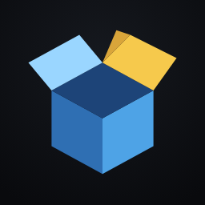

  

<h1 align="center">Masu</h1>

by ORIKAMI

<i>Bring your own dumped games to Android, with Windows coming soon. A local toolbox to import your keys and game dumps, extract, run and debug native ports, with detailed logs and one-tap crash reports. No game files, keys or source code are published here.</i>

  <a href="https://github.com/orikami-dev/masu/releases/latest">⬇️ <b>Download the latest version</b></a>
  ·
  <a href="https://github.com/orikami-dev/masu/releases">📦 All versions</a>
  ·
  <a href="CHANGELOG.md">📝 Changelog</a>

---

## 📦 The project

Masu is the toolbox that prepares and launches games dumped from your own console: you enter your keys and your games, and Masu replays the whole process locally (extraction, analysis, launch), with detailed logs for debugging. **This repository only publishes release notes and the APK of each version.** It contains no code, no game data and no keys.

| | |
|---|---|
| 🎮 **Game library** | Your dumped games appear with their name and icon; more games will be supported over time. |
| 🔑 **Your keys, your games** | Everything stays on your device, in the `MASU` folder. |
| 📤 **Extraction** | Verification, decryption and extraction of your dump, with progress and a report. |
| 🖼️ **Turnip drivers** | Automatic search and installation of drivers compatible with your graphics chip. |
| 🕹️ **Controllers** | Button hints and detection of connected controllers. |
| 🔄 **Updates** | In the app, from this repository's releases. |
| 🪟 **Windows** | 🚧 Coming soon. For now: Android. |

## 🚀 Getting started (no PC needed)

You need: an **Android 11 or newer** phone or tablet, your keys (`prod.keys` and `title.keys`) and your games (`.nsp` or `.xci`), dumped from **your own console**. Masu provides neither keys nor games, and does not explain how to get them.

1. Download `masu-<version>.apk` from the [latest release](https://github.com/orikami-dev/Masu/releases/latest) and open it. Android will ask you to allow installation from your browser or file manager.
2. Open Masu and tap **Allow**: Android shows "All files access"; turn it on for Masu. Masu then creates the `MASU` folder at the root of the storage, with `KEYS`, `GAMES`, `EXTRACTED`, `IMAGES` and `DRIVERS`.
3. Copy your files to the phone (cable, USB-C microSD reader or your usual transfer), then:
   - `prod.keys` and `title.keys` into `MASU/KEYS` (if Masu finds them elsewhere, in Downloads for example, it offers to move them for you);
   - the game into `MASU/GAMES`, with its update and DLC next to it if it has any.
4. **Extraction** tab: tap **Refresh**, choose the game, then **Extract**. Masu verifies, decrypts and stores the game in `MASU/EXTRACTED/<title id>/`, and it appears in the Library.

Good to know:

- The compressed `.nsz` and `.xcz` formats are not supported yet: decompress them to `.nsp` or `.xci` first.
- Today Masu **extracts, verifies and analyzes** your games; no game launches from the public version yet. Your feedback helps prepare the next ones.
- Masu updates are then installed from Settings > Updates.
- The app follows your phone's language: English, or French if your phone is in French.
- Optional: to install updates of your own games from a private GitHub repository, add a fine-grained token in Settings › Game updates.

## ✨ Highlights

- 🧰 Detailed logs and a ready-to-send crash report, never containing a key.
- 📱 Made for foldables: full screen, landscape, folding without restart.
- 🎨 Several themes in ORIKAMI colors.
- 🔒 No game file and no key in this repository.

## 🧪 Test with us

I can't test everything alone: every report helps Masu recognize more games and more phones.

- 📋 [Game compatibility](docs/COMPATIBILITE.md): what works, on which chip, with which version.
- ✍️ [Send a report](https://github.com/orikami-dev/Masu/issues/new?template=compatibilite.yml): the "Report compatibility" button in Masu fills in the form for you (free GitHub account required). You review it before sending; nothing leaves without you.
- 🧪 Beta versions: published here as "pre-release"; Masu offers them if you turn on the beta channel in its settings.

Only with games you own. Never share a key, a game file or personal information (name, device name, folder path).

## ⭐ Major updates

| Version | What it brought |
|---|---|
| 1.16 | Per-game apps built on the phone, clearer game picker. |
| 1.15 | English interface, game updates with your own GitHub token. |
| 1.11 ⭐ | Updates and DLC from the game page, verified downloads, version switching, saved settings. |
| 1.05 ⭐ | Game choice, updates and DLC, "Verify the dump", compatibility reports. |
| 1.00 | First public version: automatic Turnip drivers, game extraction, controller hints, in-app updates. |

## ⚖️ Good to know

Personal use only, with games you own. No game file, key or code is published in this repository.

Masu is free. Its code is not published; the licenses of the third-party code it uses are in the app (About > Licenses).

Not affiliated with Nintendo. The names and trademarks mentioned belong to their owners.
